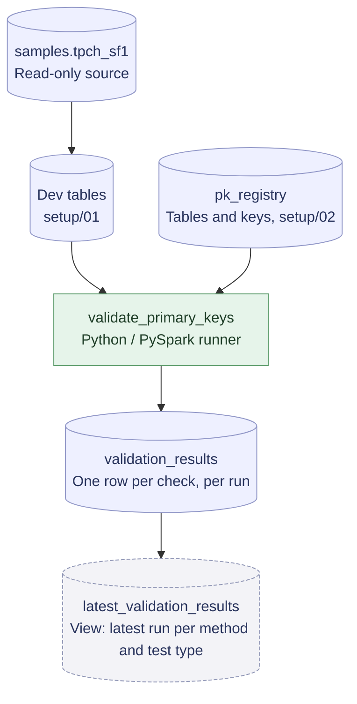

# Metadata-Driven Validation Sweep

Status: In Progress

Metadata-driven data validation framework that automates schema-wide validation without per-table code. A configurable key registry drives primary key uniqueness and null value checks across tables, and every run's results are stored in a single queryable table, with a view exposing the latest run for each validation method and test type.

Planned extensions include data freshness checks and alternative validation approaches using Databricks Labs DQX and dbt.

Tech stack: Python, PySpark, SQL, Databricks, Delta Lake, Unity Catalog

## Progress

- [x] Key registry for tables and their primary key columns
- [x] Custom Python runner that validates every registered table
- [x] Error handling: invalid registry entries are reported without stopping the run
- [x] Planted defect tables confirming duplicate and null key detection
- [x] Central results table with run history
- [ ] Freshness checks
- [ ] Databricks Labs DQX approach
- [ ] dbt approach

## How it works

Tables and their primary key columns are registered in a metadata table. The validation runner reads the registry, checks every active table for duplicate and null key values, and appends the results to a central results table. A view shows the latest run, so adding a table to the sweep only takes a new registry entry.

## Example output

Sample results from validation runs. The `_dupes` and `_nulls` tables contain deliberately planted defects, and the ERROR row comes from the error handling test:

| table_name | key_columns | test_result | row_count | null_key_count | duplicate_count |
|---|---|---|---|---|---|
| `validation_sweep.dev.customer` | `c_custkey` | PASS | 150,000 | 0 | 0 |
| `validation_sweep.dev.partsupp` | `ps_partkey`, `ps_suppkey` | PASS | 800,000 | 0 | 0 |
| `validation_sweep.dev.customer_dupes` | `c_custkey` | FAIL | 150,005 | 0 | 5 |
| `validation_sweep.dev.partsupp_nulls` | `ps_partkey`, `ps_suppkey` | FAIL | 800,004 | 4 | 0 |
| `validation_sweep.dev.customer` | `c_invalidkey` | ERROR | — | — | — |

Clean copies pass, while the defect tables fail with the exact number of planted duplicates and null keys. The invalid key column (`c_invalidkey`) was temporarily added to the registry for testing; the runner records the error in `error_message` and continues validating the remaining tables. Metrics are unavailable for checks that encounter an error.

## Repository structure

- `setup/`: notebooks that prepare test data, the key registry, the results table, and planted defects
- `runners/python_native/`: custom Python validation runner
- `exploration/`: data exploration and error handling tests

## Running it

Developed on Databricks Free Edition using the TPC-H sample data. Run the notebooks in this order:

1. `setup/01_copy_source_tables`
2. `setup/02_create_pk_registry`
3. `setup/03_create_results_table`
4. `setup/04_plant_pk_defects`
5. `runners/python_native/validate_primary_keys`