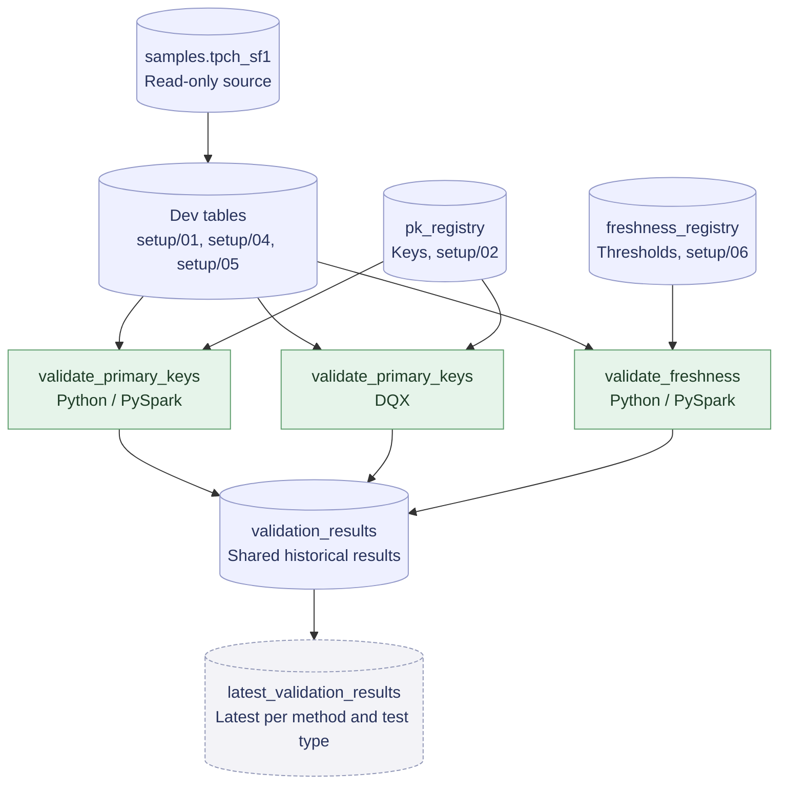

# Metadata-Driven Validation Sweep

Status: In Progress

Metadata-driven data validation framework that automates primary key and data freshness checks without per-table validation code. Configurable registries define the tables, key columns, and freshness thresholds to validate. Results from each run are stored in a central Delta table, with a view exposing the latest run for each validation method and test type.

Primary key validation is implemented using custom Python/PySpark and Databricks Labs DQX runners. Freshness validation uses Delta table history to identify the latest qualifying data-change operation and compare its age against a configurable threshold.

A dbt-based primary key validation approach is planned.

Tech stack: Python, PySpark, SQL, Databricks, Delta Lake, Unity Catalog, Databricks Labs DQX

## Progress

- [x] Key registry for tables and their primary key columns
- [x] Custom Python runner for primary key validation
- [x] Error isolation for invalid registry entries
- [x] Planted defect tables confirming duplicate and null key detection
- [x] Central results table with historical runs
- [x] Databricks Labs DQX primary key validation
- [x] Freshness registry with configurable thresholds
- [x] Python-native freshness validation using Delta history
- [x] Freshness PASS, FAIL, and ERROR testing
- [ ] dbt primary key validation approach

## How it works

Two metadata registries drive the validation framework. The primary key registry defines tables and their key columns, while the freshness registry defines tables and maximum allowable data age. Each runner reads its corresponding registry and appends results to a shared Delta table. A view exposes the latest run for each validation method and test type.

Adding a table or changing a freshness threshold requires updating registry metadata rather than modifying validation code.

## Example output

### Primary key validation

Sample results from validation runs. The `_dupes` and `_nulls` tables contain deliberately planted defects, and the ERROR row comes from the error handling test:

| table_name | key_columns | test_result | row_count | null_key_count | duplicate_count |
|---|---|---|---|---|---|
| `validation_sweep.dev.customer` | `c_custkey` | PASS | 150,000 | 0 | 0 |
| `validation_sweep.dev.partsupp` | `ps_partkey`, `ps_suppkey` | PASS | 800,000 | 0 | 0 |
| `validation_sweep.dev.customer_dupes` | `c_custkey` | FAIL | 150,005 | 0 | 5 |
| `validation_sweep.dev.partsupp_nulls` | `ps_partkey`, `ps_suppkey` | FAIL | 800,004 | 4 | 0 |
| `validation_sweep.dev.customer` | `c_invalidkey` | ERROR | — | — | — |

Clean copies pass, while the defect tables fail with the exact number of planted duplicates and null keys. The invalid key column (`c_invalidkey`) was temporarily added to the registry for testing; the runner records the error in `error_message` and continues validating the remaining tables. Metrics are unavailable for checks that encounter an error.

### Freshness validation

The Python-native freshness runner uses Delta table history to identify the latest qualifying data-change operation and compares its age against the configured threshold.

The following results demonstrate PASS and FAIL outcomes with a 24-hour threshold:

| table_name | test_result | age_hours | max_age_hours |
|---|---|---:|---:|
| `validation_sweep.dev.customer` | FAIL | 192.21 | 24 |
| `validation_sweep.dev.daily_orders` | PASS | 0.02 | 24 |

The `daily_orders` table was refreshed through a controlled UPDATE, confirming that UPDATE operations are recognized as data changes. The older `customer` table exceeded its freshness threshold.

A separate test using a nonexistent registered table confirmed ERROR handling without interrupting validation of other tables. All results are retained in the historical results table.

## Comparing approaches

Both primary key validation runners read the same registry and write to the same results table, so their latest results can be compared directly:

| table_name | method | test_result | null_key_count | duplicate_count |
|---|---|---|---|---|
| `validation_sweep.dev.customer_dupes` | dqx | FAIL | 0 | 5 |
| `validation_sweep.dev.customer_dupes` | python_native | FAIL | 0 | 5 |
| `validation_sweep.dev.partsupp_nulls` | dqx | FAIL | 4 | 0 |
| `validation_sweep.dev.partsupp_nulls` | python_native | FAIL | 4 | 0 |

Findings so far:

- Both approaches detect the same planted defects with identical counts.
- DQX flags every row involved in a duplicate (10 rows for 5 duplicated keys), while the results table counts extra rows (5). The DQX runner converts its output so both methods report the same measure.
- DQX's uniqueness check treats null keys as distinct, so a separate not-null check is needed, matching how the Python runner reports nulls separately from duplicates.
- The Python runner computes all metrics in one aggregation, while the DQX runner applies its checks separately to attribute failures, which requires additional passes over each table.

## Repository structure

- `setup/`: notebooks that prepare source tables, primary key and freshness registries, the shared results table, planted defects, and simulated table updates
- `runners/python_native/`: custom Python/PySpark runners for primary key and freshness validation
- `runners/dqx/`: primary key validation runner using Databricks Labs DQX
- `exploration/`: data exploration, DQX exploration, example result queries, and error handling tests

## Running it

Developed on Databricks Free Edition using TPC-H sample data. Run the setup notebooks in this order:

1. `setup/01_copy_source_tables`
2. `setup/02_create_pk_registry`
3. `setup/03_create_results_table`
4. `setup/04_plant_pk_defects`
5. `setup/05_simulate_table_updates`
6. `setup/06_create_freshness_registry`

Then run the validation notebooks:

- `runners/python_native/validate_primary_keys`
- `runners/dqx/validate_primary_keys`
- `runners/python_native/validate_freshness`

Each runner can be executed independently after setup.

The freshness runner uses Delta table history to identify the latest qualifying data-change operation. Operations such as `OPTIMIZE` are excluded because they reorganize files without changing table data. A qualifying operation does not necessarily mean rows were modified, so freshness represents the age of the latest qualifying Delta operation rather than a guarantee of changed business data.

The simulated updates notebook appends synthetic sample rows when rerun, so repeated execution may introduce duplicate order keys. The setup notebooks are intended for a demonstration environment; rerunning registry initialization may reset existing registrations.